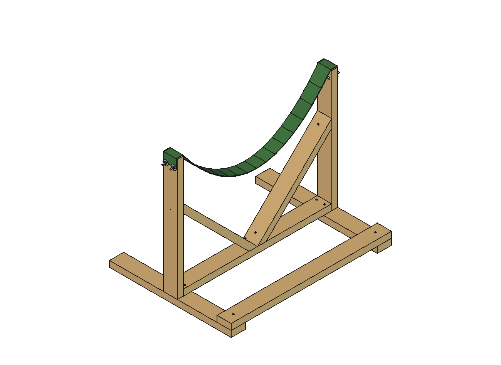
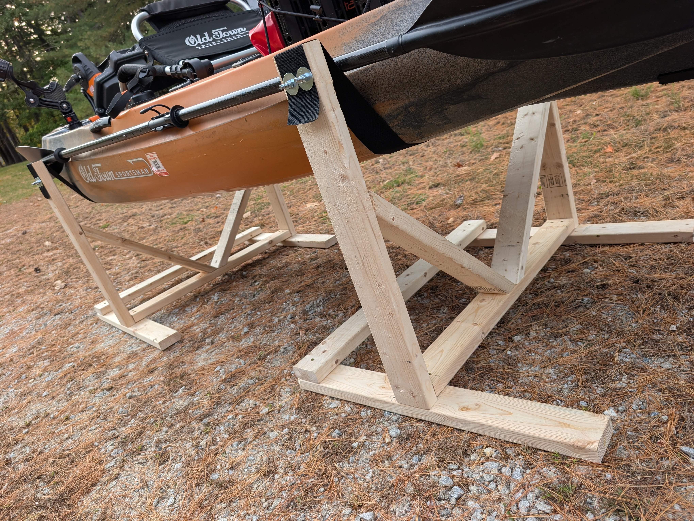

# Kayak Cradles — CAD

Parametric FreeCAD model and build docs for a pair of free-standing wooden
sling cradles, sized for an **Old Town Sportsman 106 PDL** (36" wide,
~107 lb, pedal drive removed for storage).

Each cradle is a flat vertical frame — 2 posts on 2 feet, tied together by a
bottom rail and stiffened by a 45° V-brace — with a wide polyester strap
slung between the post tops. The kayak rests belly-down in the strap, which
spreads the load so the hull won't dent. The two cradles stand ~6.5 ft apart
along the hull.

## Start here

- **`build-guide.pdf`** — step-by-step printable build guide (renders for
  every assembly step)
- **`BILL-OF-MATERIALS.md`** — complete BOM with screw schedule and cost
  estimate

## FreeCAD files

- **`cradle_model.FCStd`** / **`.step`** — pre-built model: one cradle on the
  origin, jointed assembly + hull ghost
- **`cradle_freecad.py`** — parametric generator (5 PartDesign bodies + an
  Assembly with joints); edit the `PARAMETERS` block and re-run to resize or
  regenerate the cut list

## Reference drawings & renders

- **`cut-sheet.png`** / **`.svg`** — board-by-board cutting layout
- **`photo-match-design.png`** / **`.svg`** — dimensioned end view + plan view
- **`freecad_view.png`** — full model render
- **`hardware-detail.png`** — post-top bolt / washer / nut stack close-up
- **`guide_s1_parts.png`** … **`guide_s8.png`** — per-step renders embedded
  in `build-guide.pdf`
